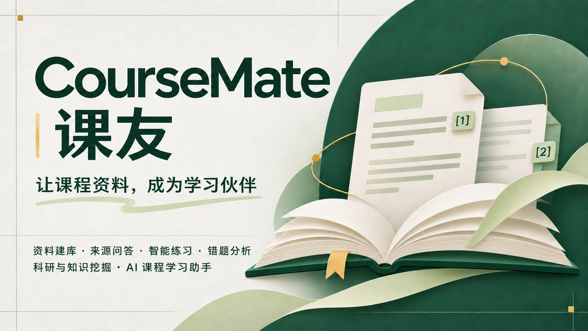
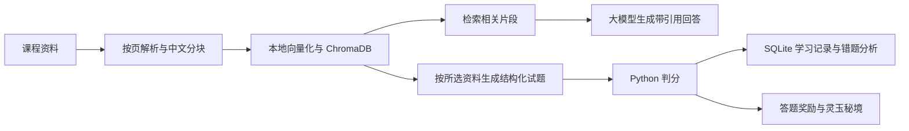

# CourseMate 课友

**让课程资料，成为学习伙伴。**

面向课程学习与专业知识梳理的 AI 助手：把自己的讲义、课件和复习资料，变成**有来源的问答、可作答的试题与可回看的学习记录**。



**参赛主题：科研与知识挖掘** · Python 3.11 · Streamlit · 本地知识库

[快速运行](#快速运行) · [体验流程](#体验流程) · [技术实现](#技术实现) · [仓库结构](#仓库结构) · [使用说明](docs/使用说明.md) · [项目海报](assets/presentation/poster.png)

| 想了解或体验什么 | 从哪里开始 | 需要准备什么 |
| --- | --- | --- |
| 了解项目功能与实现 | 阅读下方功能表、技术流程及使用边界 | 无需安装 |
| 体验完整学习流程 | 按「快速运行」启动，再用仓库样例完成「体验流程」 | Python 3.11、模型 API 密钥、首次模型下载 |
| 先体验互动游戏 | 启动后进入「灵玉秘境」→「免答题试玩新场景」 | 安装 Python 依赖即可，不需要 API 密钥或创建课程 |

## 为什么做课友

课程资料往往分散在 PDF、PPT 和讲义中。复习时，找到一个知识点、确认答案的出处、整理练习题，通常需要反复翻阅多个文件。

课友将这些操作连接起来：**资料建库 → 检索问答 → 智能练习 → 错题分析 → 复习巩固**。用户可以追溯回答的依据，也可以直接针对选中的资料练习。独立小游戏「灵玉秘境」将答题奖励转为互动挑战，为练习增加趣味。

## 能做什么

| 功能 | 实际体验 |
| --- | --- |
| **课程与资料管理** | 按课程组织 PDF、DOCX、TXT、PPTX、PPT；支持批量上传、处理状态查看、重建索引与删除。 |
| **带来源的知识问答** | 回答附文件名、页码及引用片段，可展开核对；依据不足时提示无法回答。 |
| **指定资料生成试题** | 必选一份或多份已入库资料，支持全选；可生成 1–10 道单选题或判断题。 |
| **自动判分与解析** | 提交后查看得分、逐题对错、正确答案与解析；判分由 Python 完成。 |
| **学习分析** | 查看当前课程的作答正确率、错题、知识点表现，并按真实作答记录生成复习建议。 |
| **游戏化练习** | 战前答题赚灵玉，进入「灵玉秘境」进行字牌合成、棋盘布阵与十二波防守；也可免答题试玩。 |
| **可视化模型设置** | 页面填写 API 地址、密钥和模型名称，支持接口预设与连接测试，保存后立即生效，无需编辑配置文件。 |

问答页提供「帮我总结这些资料」「帮我找一下这个知识点的位置：」提示，点击只填入输入框，编辑后再发送。开启 Agent 自动路由后，还可用自然语言请求出题或查看错题。

## 快速运行

本项目提供**可在本机运行的源码**，GitHub 仓库地址不是在线应用入口。完整 AI 问答和出题需要用户自行配置有效的大模型 API 密钥。

### 1. 下载并安装

推荐 **Python 3.11**，已在 Windows / Python 3.11.15 环境验证。以下为 PowerShell 命令：

```powershell
git clone https://github.com/Evan-Yi-fan/CourseMate.git
cd CourseMate
python -m venv .venv
.\.venv\Scripts\python.exe -m pip install -r requirements.txt
```

首次安装包含本地向量模型所需的 PyTorch 等依赖，请预留下载时间和磁盘空间。使用其他系统时，将命令中的 Python 路径换成 `.venv/bin/python`；旧版 `.ppt` 的转换仅支持 Windows + 本机 PowerPoint。

### 2. 启动

```powershell
.\.venv\Scripts\python.exe -m streamlit run app.py
```

浏览器打开 **http://localhost:8501**。

### 3. 在页面配置模型

进入侧边栏 **「模型设置」**，无需先创建课程：

1. 选择 DeepSeek、通义千问兼容接口或自定义接口。
2. 填写 **API 地址、API 密钥、模型名称**，模型 ID 以供应商账号实际可用列表为准。
3. 点击「测试当前填写配置」验证连接，再点击「保存配置」立即应用；测试会发送一条短消息，可能产生少量 API 用量。

配置仅保存在本机数据目录，下次启动仍可使用。已有密钥不回填到输入框；相同地址可留空沿用，更换地址需重新输入密钥。保存本身不发起模型请求。

向量化默认使用本地中文模型 `BAAI/bge-small-zh-v1.5`，首次使用会下载模型，无需额外向量 API 密钥。更换聊天模型不需要重建资料索引。高级选项可将 `.env.example` 复制为 `.env` 后配置；首次下载保持 `EMBEDDING_OFFLINE=false`，缓存完成后可设为 `true`。详见[使用说明](docs/使用说明.md)。

没有 API 密钥时，也可启动首页，进入「灵玉秘境」点击**免答题试玩新场景**，体验游戏；完整学习流程仍需模型配置。

## 体验流程

仓库自带一份原创「数字图像处理」样例课件和补充讲义，无需准备自己的资料。

| 步骤 | 操作 | 可以观察到的结果 |
| --- | --- | --- |
| 1. 建立课程 | 首页创建「数字图像处理」，只填课程名称。 | 课程出现在列表中，可设为当前课程。 |
| 2. 导入资料 | 在「课程知识库」上传 `samples/` 中的 PDF 和 TXT。 | 文件显示已入库及向量块数量，处理后上传栏自动清空。 |
| 3. 查证知识 | 在「AI 智能问答」问「直方图均衡化的作用是什么？」并展开引用。 | 查看回答对应的文件、页码和资料片段。 |
| 4. 检查边界 | 再问一个资料未涉及的问题，例如「这份课件作者的生日是哪天？」。 | 观察资料不足时的提示，而非把模型常识当作课件依据。 |
| 5. 练习与反馈 | 在「智能试题」选择资料、题型和题数，生成后提交答案。 | 查看程序判分、正确答案与解析；建议保留一次错题记录。 |
| 6. 复习与互动 | 在「学习分析」查看错题；或到「灵玉秘境」完成战前答题。 | 查看学习表现与复习建议，或使用答题奖励进入游戏。 |

也可在模型配置完成后，运行以下命令一次性建立样例课程并导入资料；重复执行会跳过已入库的同名样例：

```powershell
.\.venv\Scripts\python.exe scripts/seed_demo.py
```

## 技术实现



- **检索增强生成（RAG）**：先从当前课程资料检索片段，再将片段作为上下文交给模型，回答可展开核对来源。
- **课程与范围隔离**：每门课程使用独立向量集合；出题会校验资料归属，并只从所选文件取样。
- **减少无依据回答**：结合检索相似度阈值与模型侧资料不足提示，降低编造风险；引用与拒答仍需用户核对，不能保证完全消除模型错误。
- **生成与判分分工**：模型负责生成试题和解析，程序校验题型、数量、选项与答案结构，Python 负责判分与答题奖励。
- **独立游戏前端**：游戏采用 HTML / CSS / JavaScript，通过 iframe 展示；配置由 Python 注入，场景使用项目自绘 SVG。

| 层次 | 技术 |
| --- | --- |
| 应用界面 | Streamlit、Plotly |
| 模型调用 | OpenAI Python SDK，兼容接口 |
| 文档解析 | PyMuPDF、python-docx、python-pptx；旧 PPT 使用 PowerPoint 转换 |
| 知识检索 | sentence-transformers、bge-small-zh-v1.5、ChromaDB |
| 学习数据 | SQLite |
| 游戏与验证 | 原生 HTML / CSS / JavaScript、unittest、Streamlit AppTest、jsdom |

## 灵玉秘境

战前出题与「智能试题」使用相同的资料多选、题型和题数设置。**每局初始 30 灵玉，每答对一题增加 10 点，答错不扣，不设连对、完成或全对额外奖励。** 免答题试玩与游戏内重开均从 30 灵玉开始，重开不重复发放答题奖励。

取出未被遮挡的字牌，三张同字合成上阵；棋盘同阶同字可继续融合，最高四星。备战与闯关中均可拖动、交换文字；神兽残字只有在棋盘上从左到右横排组成「青龙」或「白虎」才激活，也可拖走单字拆解。怪物沿棋盘外的开放直角道路行进，守住人皇即可通关。

## 数据与使用边界

- **本机存储**：上传文件、向量索引和学习记录保存在 `data/`，仓库不包含个人课程资料或真实 API 密钥。
- **模型设置**：界面配置保存在本机 `data/model_settings.json`，密钥以明文保存且不提交到 GitHub，请勿分享该文件。界面保存的模型配置优先于环境变量和 `.env`。
- **模型请求**：使用远端模型时，问题、相关资料片段或复习所需的错题信息会发送给配置的供应商；本机保存不等于完全离线。
- **解析范围**：不含 OCR。扫描 PDF、图片课件中的文字及复杂 SmartArt 不保证提取；PPTX 不需要 Office，旧 PPT 需要 Windows 本机 PowerPoint。
- **删除范围**：删除资料会清理对应文件与索引，保留历史题目和作答；删除课程会清理整门课程的文件、索引及学习记录，均需页面确认。
- **运行方式**：面向单用户本地使用，没有登录及多租户隔离。游戏在 iframe 中运行，操作外层 Streamlit 控件可能重置本局；游戏进度未持久化。

## 验证

当前验证：**147 项 Python 用例、148 项游戏断言通过**，覆盖资料解析、检索与课程隔离、问答引用、出题校验、判分奖励、删除回退和关键页面交互。自动化测试不替代真实模型效果与完整浏览器体验验收，也不代表已经验证学习成绩提升。

```powershell
# Python 功能与页面回归
.\.venv\Scripts\python.exe -m unittest discover -s tests -v

# 游戏交互回归（仅测试需要 Node.js，日常运行不需要）
npm --prefix tests/game ci
npm --prefix tests/game test
```

测试使用临时数据库和资料目录，不会覆盖正常使用时保存的课程数据。Node.js 依赖只安装在 `tests/game/node_modules/`，与应用运行资源分开。

## 仓库结构

根目录保留启动、安装和项目说明入口，其他文件按用途归类：

```text
CourseMate/
├── README.md               项目介绍与快速体验
├── app.py                  Streamlit 启动入口与首页
├── requirements.txt        Python 安装入口
├── .env.example            模型与存储配置模板
├── pages/                  知识库、问答、试题、分析、游戏与模型设置
├── ui/                     共用交互与主题
│   ├── common.py           页面初始化、课程选择与导航
│   ├── quiz.py             两处出题入口共用设置
│   └── theme.css           主应用样式
├── services/               资料管理、问答、出题判分与分析
├── knowledge/              解析、分块、向量化与检索
├── agent/                  自然语言意图路由与工具
├── database/               SQLite 数据访问
├── config/                 环境与本机模型设置读取、保存、校验
├── modes/                  普通答题界面与接口
├── game/                   游戏配置、奖励与页面组装
│   └── web/                游戏 HTML、CSS、JS 与 SVG
├── samples/                原创体验资料
├── scripts/                环境自检、样例导入与生成
├── tests/                  Python 回归测试
│   └── game/               游戏交互测试及 Node 依赖清单
├── requirements/           完整依赖版本锁定记录
├── assets/presentation/    正式封面与海报
└── docs/使用说明.md         操作详情、格式限制与常见问题
```

安装与运行时，本机会生成 `.venv/`（Python 环境）和 `data/`（资料与学习数据）；它们以及 `.env` 均不进入公开仓库。安装以根目录 `requirements.txt` 为准，`requirements/locked.txt` 用于核对已验证环境的完整依赖版本。

## 展示材料

**作品名称**：CourseMate 课友  
**参赛主题**：科研与知识挖掘

**作品简介**：CourseMate 课友是一款基于课程资料的 AI 学习助手，支持 PDF、DOCX、TXT、PPTX、PPT 资料管理、带来源引用的知识问答、智能出题、自动判分与错题分析，帮助用户完成从知识检索到练习复习的学习流程，并通过答题奖励与互动小游戏增添学习趣味。

[下载正式封面](assets/presentation/cover.png) · [查看官方模板海报](assets/presentation/poster.png) · [查看源码仓库](https://github.com/Evan-Yi-fan/CourseMate)
